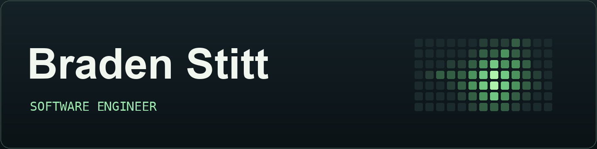

I started with a 25-minute Pomodoro timer. These days I'm building software that takes an order all the way from checkout to a finished film, including what happens when a scene fails halfway through.

[Your Story Movie](https://www.yourstorymovie.com) · [LinkedIn](https://www.linkedin.com/in/braden-stitt-394b78235/) · [Email](mailto:stittbraden@gmail.com)

## Selected work

**[Your Story Movie ↗](https://www.yourstorymovie.com)** 
Personalized animated films. I've worked on guest checkout, name pronunciation, and getting finished films to customers automatically.

**[gitmem ↗](https://github.com/BradenStitt/gitmem)** 
Version-controlled memory for AI agents. Agents can save structured context and pick up where they left off across sessions.

**[Vanish ↗](https://github.com/BradenStitt/Vanish)** 
Blurs bystanders in photos and video while keeping the main subject visible. Built with Florence-2 and SAM 2.

**[AG-UI Protocol Demo ↗](https://github.com/BradenStitt/AG-UI-Protocol-Demo)** 
An example of connecting a Python agent to a React app using PydanticAI, CopilotKit, and AG-UI.

[My 25-minute timer ↗](https://github.com/BradenStitt/Pomodoro-App)
